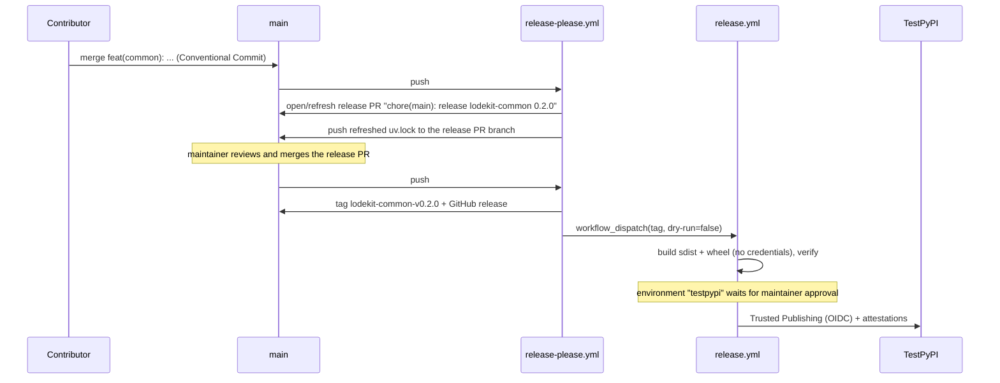

# Releasing

Every package is versioned and released on its own (SemVer, ADR-001). Everything stays `0.x` until
M5. Breaking changes are allowed in a `0.x` minor release, but must appear in the changelog.
**Nothing is published without the maintainer's approval.**

## How a release happens



1. **Release PRs.** [`release-please.yml`](https://github.com/nakicam/lodekit/blob/main/.github/workflows/release-please.yml)
   runs on every push to `main`.
   - It uses release-please in manifest mode with `separate-pull-requests`, so each package gets
     its own release PR, `CHANGELOG.md` and version bump.
   - Commits are attributed to a package by path. The scope convention (`feat(common): …`) keeps
     history readable.
2. **Lockfile.** release-please does not update `uv.lock`. After it creates or updates a release
   PR, the workflow runs `uv lock` on that PR branch and pushes the change, so `uv lock --check`
   stays green.
3. **Tags.** Merging a release PR creates the tag `<pkg>-v<semver>` (e.g. `lodekit-common-v0.1.0`)
   and a GitHub release.
4. **Dispatch.** Tags created with the default `GITHUB_TOKEN` do not trigger other workflows. For
   that reason, release-please explicitly dispatches
   [`release.yml`](https://github.com/nakicam/lodekit/blob/main/.github/workflows/release.yml)
   with the tag.
5. **Build.** In a job **without credentials**, `release.yml`:
   - checks out the tag;
   - verifies that the tag version equals the `pyproject.toml` version;
   - builds sdist and wheel with `uv build --package <pkg> --no-sources`;
   - runs `twine check --strict`;
   - installs the wheel into a clean venv and checks its version.
6. **Publish.** A separate job uses the protected `testpypi` environment, so it waits for the
   maintainer's approval. It then:
   - creates a GitHub build-provenance attestation;
   - publishes to TestPyPI with `pypa/gh-action-pypi-publish` via Trusted Publishing (OIDC, no
     tokens), with PEP 740 attestations.

PyPI (production) publishing is added after gate G3, with its own `pypi` environment.

## Adding a package to the release flow

Add the package path to `release-please-config.json` and its current version to
`.release-please-manifest.json`:

```json
// release-please-config.json
"packages": {
  "packages/lodekit-common": {"package-name": "lodekit-common", "component": "lodekit-common"}
}
// .release-please-manifest.json
{"packages/lodekit-common": "0.1.0"}
```

While `packages` is empty, the workflow skips release-please.

## One-time setup (maintainer, not done yet)

These steps need admin rights and are **not** performed by automation.

1. **GitHub environment `testpypi`** (Settings → Environments):
   - required reviewer `@nakicam`;
   - "Prevent self-review" off (single maintainer);
   - deployment branches and tags: selected tags matching `lodekit*-v*`, plus `main` for
     dispatches.
2. **TestPyPI pending publisher** for each package (<https://test.pypi.org/manage/account/publishing/>):
   - PyPI project name: `lodekit-common`
   - owner: `nakicam`
   - repository: `lodekit`
   - workflow: `release.yml`
   - environment: `testpypi`

   A pending publisher does **not** reserve the name, so register it shortly before the first
   upload.
3. **Optional: `RELEASE_PLEASE_TOKEN` secret.** Release PRs opened with `GITHUB_TOKEN` do not
   trigger CI. Without the secret, close and reopen the release PR to run CI. Alternatively, store
   one of these as `RELEASE_PLEASE_TOKEN`:
   - a fine-grained PAT (contents, pull requests: read and write);
   - preferably, a GitHub App token.

## Dry run

The default dispatch is a dry run. It builds and verifies but never publishes.

```console
gh workflow run release.yml -f tag=lodekit-common-v0.1.0            # dry-run=true by default
gh run watch
```

Locally, the same checks are:

```console
uv build --package lodekit-common --no-sources --out-dir dist
uvx twine check --strict dist/*
uv venv .venv-verify && uv pip install --python .venv-verify dist/*.whl
.venv-verify/bin/python -c "import lodekit.common, importlib.metadata as m; print(m.version('lodekit-common'))"
```

To preview what release-please would do, without changing anything:

```console
npx release-please release-pr --dry-run --repo-url nakicam/lodekit --token "$(gh auth token)" \
  --config-file release-please-config.json --manifest-file .release-please-manifest.json
```
