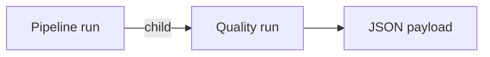

# Correlate nested runs with `RunContext`

Give every run a traceable identity and link a quality check to the pipeline run that started it.

| | |
|---|---|
| **Milestone** | M0 |
| **Packages** | `lodekit-common` |
| **Time to run** | < 1 min from a clean environment |
| **Needs network / API key** | No |
| **Data** | none (see [Data](#data)) |
| **Status** | pre-alpha · names are working titles |

## What you'll build

- A run context for a pipeline run, tagged `nightly`.
- A child context for a quality check that points back to the pipeline run.
- The JSON payload and JSON schema that other tools can rely on.



## Prerequisites

- Python 3.11–3.14
- [uv](https://docs.astral.sh/uv/) (recommended) or `pip`

## Run it

From the repository root:

```bash
uv run --package example-run-context python examples/run-context/main.py
```

or with pip, from this folder (once `lodekit-common` is published):

```bash
python -m venv .venv
# bash: source .venv/bin/activate    PowerShell: .venv\Scripts\Activate.ps1
pip install "lodekit-common>=0.1,<0.2"
python main.py
```

### Expected output

Run IDs and timestamps differ on every run.

```text
pipeline run_id=21da8964-ac0f-4f65-ad1b-84f011d26235
quality  run_id=035f7758-77ec-48a9-b89e-2b5ee86a741d
quality parent_run_id matches: True
tags=('nightly', 'eu')
{
  "run_id": "035f7758-77ec-48a9-b89e-2b5ee86a741d",
  "parent_run_id": "21da8964-ac0f-4f65-ad1b-84f011d26235",
  "component": "lodekit-quality",
  …
}
schema fields: "run_id", "parent_run_id", "component", "started_at", "tags"
```

**Key result:** `quality parent_run_id matches: True`, so the quality run is linked to the pipeline run.

## What just happened

1. `RunContext(component="lodekit-flow", tags=("nightly",))` created the pipeline run with a fresh
   `run_id` and a UTC start time. See the
   [`lodekit-common` API](../../docs/api/lodekit-common.md).
2. `pipeline.child("lodekit-quality", tags=("eu",))` created a nested run: new `run_id`,
   `parent_run_id` set to the pipeline run, tags inherited and extended.
3. `model_dump_json()` produced the payload that logs and traces can carry.
4. `run_context_json_schema()` returned the JSON schema that is part of the public contract.

## Try next

- Add a third level, e.g. `quality.child("lodekit-agents")`, and print its `parent_run_id`.
- Print the full schema with `python -m lodekit.common`.

## Troubleshooting

| Symptom | Fix |
|---|---|
| `ModuleNotFoundError: lodekit.common` | install the package: `pip install lodekit-common` |
| `ValidationError` on `component` | use lower-case names such as `my-tool` (pattern `^[a-z][a-z0-9_.-]*$`) |

## Data

This example uses no dataset. See [`examples/DATA_LICENSES.md`](../DATA_LICENSES.md).

---

<sub>Part of **lodekit**, licensed under Apache-2.0.</sub>
